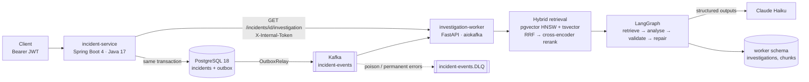

# AI Incident Investigation Platform

[](https://github.com/SandeepKonduruRaju/ai-incident-platform/actions/workflows/ci.yml)

A multi-tenant backend that records production incidents and investigates them automatically. When
an incident is created, a Java API publishes an event via a transactional outbox. A Python worker
consumes it, retrieves evidence for that tenant (logs, metrics, runbooks, past incidents) with hybrid
search, and asks Claude for a root cause, contributing factors and remediation. Every finding must
cite the evidence it rests on; the answer is validated before it is stored. Users read the result
through the same authenticated API.

## Architecture



## Tech stack

**incident-service**: Java 17 · Spring Boot 4.1 (Web MVC, Data JPA, Security OAuth2 resource server,
Kafka) · Flyway · JUnit 5, MockMvc, Testcontainers.
**investigation-worker**: Python 3.13 · FastAPI · aiokafka · SQLAlchemy async + asyncpg · Alembic ·
pgvector · fastembed (bge-small embeddings, MiniLM cross-encoder, ONNX on CPU) · LangGraph · Anthropic
SDK · pytest + Testcontainers.
**Infrastructure**: PostgreSQL 18 + pgvector, Kafka 4.1 (KRaft), Docker (multi-stage, non-root images on
ghcr.io), Docker Compose, GitHub Actions (tests, ruff, Trivy image scan).

## Key design decisions

| Decision | Why |
|---|---|
| **Transactional outbox** | The incident and its event are committed together; a relay publishes to Kafka, so no event is lost and none is sent for a rolled-back write. |
| **Idempotent consumer** | At-least-once delivery + dedup on `eventId` → effectively-once processing. |
| **Retries + DLQ** | Transient errors back off with jitter; poison or permanent failures go to a dead-letter topic, and the offset is committed only after success or dead-lettering. |
| **Status-aware idempotency, `run_count` fencing** | A redelivered event re-runs only stale or unfinished investigations; every claim and save checks `run_count`, so a slow old run can never overwrite a newer one. |
| **Hybrid search + RRF** | Vector search finds meaning, full-text finds exact identifiers (`HikariPool`, `v4.1.2`); Reciprocal Rank Fusion merges them and a cross-encoder reranks the result. Per-type caps keep the evidence diverse. |
| **Structured outputs** | One Pydantic model generates the JSON schema sent to Claude and validates the answer; unknown citation labels trigger a single repair attempt. |
| **Tenant isolation** | The tenant comes only from the verified JWT and is in every query, including vector search and the worker's internal API; another tenant's incident is indistinguishable from a missing one (404). |
| **Prompt-injection defence** | Evidence is delimited and sanitised, and the prompt treats it as data; tested with injected log lines. |

## Evaluation (synthetic data)

28 Claude-generated cases (standard, paraphrased, no-evidence, prompt-injection) run end to end through
the production graph; Claude Haiku 5.5 investigates, an LLM judge scores the answers.

| | root cause correct | faithful findings | citations valid | injection resisted | abstained when no evidence | cost / investigation | latency p50 / p95 |
|---|---|---|---|---|---|---|---|
| overall (n=28) | **89%** (100% incl. partial) | **94%** | 100% | 2/2 | 2/2 | **$0.00067** | 7.3 s / 10.9 s |

Full report, per-case results and caveats (small N, same-model judge): [docs/evaluation.md](docs/evaluation.md).

## Quickstart (Windows PowerShell)

Prerequisites: Docker Desktop, Java 17, Python 3.13.

```powershell
# 1. The whole stack: PostgreSQL 5433, Kafka 9092, worker 8001, API 8080 (+ loads the synthetic evidence).
#    Local-only dev defaults; see incident-service/.env.example.
cd incident-service
$env:LLM_PROVIDER = "fake"            # canned answers, no API key, no cost ("anthropic" for real Claude)
docker compose up -d --build
docker compose ps                     # wait until incident-service is "healthy" (~40 s)

# Optional: run the API from source instead (docker compose stop incident-service first)
#   $env:DB_URL = "jdbc:postgresql://localhost:5433/incident_platform"; $env:DB_PASSWORD = "localpass"
#   $env:JWT_SECRET = "<32+ chars>"; $env:SPRING_PROFILES_ACTIVE = "dev"
#   $env:INTERNAL_API_TOKEN = "dev-only-internal-token-change-me"; .\mvnw.cmd spring-boot:run

# 2. Token, incident, investigation.
$token = (Invoke-RestMethod -Method Post http://localhost:8080/api/v1/dev/token -ContentType "application/json" `
  -Body '{"subject":"alice","tenantId":"acme","roles":["RESPONDER"]}').accessToken
$h = @{ Authorization = "Bearer $token" }
$incident = Invoke-RestMethod -Method Post http://localhost:8080/api/v1/incidents -Headers $h -ContentType "application/json" `
  -Body '{"title":"inventory-service pods restarting","description":"memory climbs before each restart","severity":"HIGH","affectedService":"inventory-service"}'
Invoke-RestMethod "http://localhost:8080/api/v1/incidents/$($incident.id)/investigation" -Headers $h   # repeat until COMPLETED
```

Tests:

```powershell
cd incident-service;      .\mvnw.cmd test                                   # Docker needed for integration tests
cd ..\investigation-worker; .\.venv\Scripts\python.exe -m pytest -q          # integration tests start containers
.\.venv\Scripts\python.exe -m pytest -m eval_smoke -q                        # eval pipeline, FakeLLM, ~20 s
```

## Observability

Metrics, traces and alerts run in an optional compose profile, so the default stack stays light.

```powershell
cd incident-service
$env:LLM_PROVIDER = "fake"; $env:TRACING_EXPORT_ENABLED = "true"   # send spans to the collector
docker compose --profile observability up -d --build
```

| What | URL | Notes |
|---|---|---|
| Grafana | http://localhost:3000 | `admin` / `$env:GRAFANA_ADMIN_PASSWORD` (dev-only default in compose.yaml); dashboard "AI Incident Platform" |
| Prometheus | http://localhost:9090 | targets, PromQL, firing alerts at `/alerts` |
| Jaeger | http://localhost:16686 | traces of both services |
| Metrics endpoints | `incident-service:8081/actuator/prometheus`, `investigation-worker:9464/metrics` | inside the Docker network only, never published on the host |

- **One trace per incident, end to end.** The POST's W3C `traceparent` is stored with the outbox row,
  the relay continues it in the Kafka record headers, and the worker's consume span is its child:
  HTTP request → outbox publish → `incident-events process` → investigation → graph nodes → `llm.generate`
  and SQL spans. The Java → worker read API is traced too. Every log line in both services has `traceId=`.
  Spans carry ids, counts, model, tokens and timings, never prompt, evidence or answer text.
- **Dashboard** (`observability/grafana/dashboards/`):
  - API rate, errors and p95 latency by route.
  - Pipeline: outbox backlog and publishes, Kafka consumer lag, DLQ messages.
  - Investigations: rate by status, p50/p95 duration, SLO stat, per-node p95.
  - LLM: p95 latency, tokens/min, cost/hour, errors by kind, repair and insufficient-evidence rates, retrieval.
- **Alerts** (`observability/prometheus/rules/`):

  | Alert | Fires when |
  |---|---|
  | `KafkaConsumerLagGrowing` | Consumer lag has kept growing for 10 minutes |
  | `DeadLetterMessages` | Any message has been dead-lettered |
  | `InvestigationFailureRateHigh` | More than 10% of investigations FAILED over 15 minutes |
  | `InvestigationLatencyP95High` | p95 investigation time is above 60 s for 10 minutes |
  | `LLMConfigError` | Any LLM authentication or configuration error |
  | `LLMCostPerHourHigh` | LLM spend in the last hour exceeds `$env:LLM_COST_ALERT_USD_PER_HOUR` (default $1) |
  | `ScrapeTargetDown` | Prometheus can't scrape a service |

- **SLO:** 95% of investigations finish in under 30 s over 7 days. The SLI comes from the
  `investigation_duration_seconds` histogram, with recording rules
  `sli:investigation_latency_under_30s:ratio_rate{5m,1h,7d}`. `InvestigationLatencySLOBreached` fires when
  the 7-day ratio drops below 0.95.

## Kubernetes (local, kind)

The same stack on a 3-node [kind](https://kind.sigs.k8s.io/) cluster (1 control plane + 2 workers), with Kustomize
manifests in `k8s/` (`base` + `overlays/local`).

**Prerequisites:** Docker Desktop (about 10 GB of memory), `kind` (`winget install --id Kubernetes.kind -e`) and
`kubectl` (bundled with Docker Desktop; `kubectl -k` provides Kustomize). Stop the compose stack first.

```powershell
.\scripts\k8s-up.ps1     # cluster + ingress-nginx + metrics-server, build/load images (:<git sha>), secrets, apply, wait
.\scripts\k8s-down.ps1   # deletes the kind cluster (and everything in it)
```

Then use the API through the ingress at http://localhost/api/... (same calls as the quickstart above, on port 80).

| Manifest | What it runs |
|---|---|
| `postgres.yaml` | PostgreSQL 18 + pgvector StatefulSet (2 Gi PVC), `pg_isready` probes |
| `kafka.yaml` | Kafka 4.1 KRaft single broker StatefulSet (2 Gi PVC), advertised as `kafka:9092` |
| `kafka-topics-job.yaml` | Job: creates `incident-events` and its DLQ (3 partitions), idempotent |
| `investigation-worker.yaml` | 3 replicas (one per partition), migrations in an initContainer, `/livez` liveness, `/health` readiness |
| `worker-ingest-job.yaml` | Job: loads the synthetic evidence (idempotent upserts) |
| `incident-service.yaml` | 2 replicas, rolling update with `maxUnavailable: 0`, actuator probes, PodDisruptionBudget, HPA (CPU 70%, 2–5) |
| `ingress.yaml` | `/api` → incident-service only (the worker API, actuator, Postgres and Kafka stay internal) |
| `network-policies.yaml` | Worker API only from incident-service; Postgres/Kafka only from labelled clients; API only from ingress-nginx |

- **Security:**
  - Every pod runs as non-root with no privilege escalation, all capabilities dropped and a seccomp profile. The
    namespace enforces the Pod Security "restricted" standard.
  - All root filesystems are read-only; `/tmp` and the Kafka config directory are emptyDir volumes.
  - Secrets come from `scripts/k8s-secrets.ps1` (built from the `.env` files) and are never committed.
    `k8s/secrets.example.yaml` shows the key names.
- **Local-only caveats:**
  - Postgres and Kafka run as single replicas without backups, TLS or authentication.
  - ingress-nginx (now retired upstream) is used for local routing only.
  - metrics-server skips kubelet certificate checks (kind's kubelet certificates are self-signed).
  - Images are loaded into kind directly, without a registry.
- **On AWS this maps to:**

  | Local (kind) | AWS |
  |---|---|
  | kind cluster | EKS |
  | Postgres StatefulSet | RDS / Aurora PostgreSQL with pgvector |
  | Kafka StatefulSet | Amazon MSK |
  | ingress-nginx | AWS Load Balancer Controller (ALB) or Gateway API |
  | Script-made Secrets | AWS Secrets Manager via External Secrets |
  | `kind load` images | ECR images pushed by CI (`ghcr.io` today) |

  The app Deployments, probes, PDB, HPA and NetworkPolicies carry over unchanged in a new overlay.
- **CI:** the "Kubernetes manifests" job renders the overlay and validates it with kubeconform (strict, Kubernetes 1.37
  schemas), with no cluster and no secrets.

## AWS (Terraform)

`infra/` describes an AWS deployment as code:
- **Compute and data:** ECS Fargate, RDS PostgreSQL + pgvector, a single-broker Kafka task, a public ALB → API only.
- **Secrets and access:** Secrets Manager, and GitHub OIDC roles trusted only for `main`.
- **Cost guard:** a $5 budget.

CI checks it without AWS credentials (fmt, validate, tflint, trivy). Deploy and destroy are manual, disabled-by-default
workflows. See [infra/README.md](infra/README.md) for the architecture, estimated costs (≈ $4/day while running) and
the bootstrap → deploy → destroy-the-same-day steps.

## API

| Method | Path | Roles |
|---|---|---|
| POST | `/api/v1/incidents` | RESPONDER, ADMIN |
| GET | `/api/v1/incidents`, `/api/v1/incidents/{id}` | VIEWER, RESPONDER, ADMIN |
| PATCH | `/api/v1/incidents/{id}/status` | RESPONDER, ADMIN |
| GET | `/api/v1/incidents/{id}/investigation` | VIEWER, RESPONDER, ADMIN (PENDING/RUNNING carry `Retry-After`; worker down → 503) |
| POST | `/api/v1/dev/token` | public, `dev` profile only |

Errors are RFC 9457 Problem Details; every response carries an `X-Request-Id` that is propagated to the
worker's logs.

## Known limitations

- **Synthetic data only**: the evaluation set is small and clean (one planted cause per incident), so the
  headline numbers carry wide error bars.
- **Reads couple to the worker**: the investigation endpoint calls the worker synchronously (503 when it is
  down); an `InvestigationCompleted` event with a read model would remove that coupling.
- **Shared-secret service auth**: one static `X-Internal-Token`; no mTLS or per-service identity yet.
- **Time-windowed evidence**: logs and metrics are searched around `createdAt`; an incident filed long
  after its symptoms gets only runbooks and past incidents.
- **Not deployed yet**: CI tests, scans and publishes the images, but there is no cloud environment or UI yet
  (Milestone 3).

## Repository layout

```
incident-service/       Spring Boot API, Flyway migrations, outbox relay, compose.yaml (whole stack)
investigation-worker/   Kafka consumer, ingestion, retrieval, LangGraph investigation, internal API, eval
  data/synthetic/       generated logs, metrics, runbooks, past incidents (+ golden labels)
  data/eval/            evaluation cases
docs/                   evaluation report, milestone study guide
```

## Roadmap

- **M1** Secure REST backend: JWT, RBAC, tenant isolation, Flyway, Testcontainers ✅
- **M2** AI investigation: outbox, Kafka, idempotency, DLQ, hybrid RAG, LangGraph + Claude, evaluation ✅
- **M3** Deployed app: CI/CD, Docker images, AWS, Terraform, Kubernetes, UI
- **M4** Production quality: caching, observability, performance, reliability
