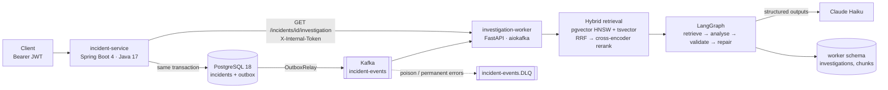

# AI Incident Investigation Platform

[](https://github.com/SandeepKonduruRaju/ai-incident-platform/actions/workflows/ci.yml)

A multi-tenant backend that records production incidents and investigates them automatically. When
an incident is created, a Java API publishes an event via a transactional outbox. A Python worker
consumes it, retrieves evidence for that tenant (logs, metrics, runbooks, past incidents) with hybrid
search, and asks Claude for a root cause, contributing factors and remediation. Every finding must
cite the evidence it rests on; the answer is validated before it is stored. Users read the result
through the same authenticated API.

## Architecture



## Tech stack

**incident-service**: Java 17 · Spring Boot 4.1 (Web MVC, Data JPA, Security OAuth2 resource server,
Kafka) · Flyway · JUnit 5, MockMvc, Testcontainers.
**investigation-worker**: Python 3.13 · FastAPI · aiokafka · SQLAlchemy async + asyncpg · Alembic ·
pgvector · fastembed (bge-small embeddings, MiniLM cross-encoder, ONNX on CPU) · LangGraph · Anthropic
SDK · pytest + Testcontainers.
**Infrastructure**: PostgreSQL 18 + pgvector, Kafka 4.1 (KRaft), Docker Compose.

## Key design decisions

| Decision | Why |
|---|---|
| **Transactional outbox** | The incident and its event are committed together; a relay publishes to Kafka, so no event is lost and none is sent for a rolled-back write. |
| **Idempotent consumer** | At-least-once delivery + dedup on `eventId` → effectively-once processing. |
| **Retries + DLQ** | Transient errors back off with jitter; poison or permanent failures go to a dead-letter topic, and the offset is committed only after success or dead-lettering. |
| **Status-aware idempotency, `run_count` fencing** | A redelivered event re-runs only stale or unfinished investigations; every claim and save checks `run_count`, so a slow old run can never overwrite a newer one. |
| **Hybrid search + RRF** | Vector search finds meaning, full-text finds exact identifiers (`HikariPool`, `v4.1.2`); Reciprocal Rank Fusion merges them and a cross-encoder reranks the result. Per-type caps keep the evidence diverse. |
| **Structured outputs** | One Pydantic model generates the JSON schema sent to Claude and validates the answer; unknown citation labels trigger a single repair attempt. |
| **Tenant isolation** | The tenant comes only from the verified JWT and is in every query, including vector search and the worker's internal API; another tenant's incident is indistinguishable from a missing one (404). |
| **Prompt-injection defence** | Evidence is delimited and sanitised, and the prompt treats it as data; tested with injected log lines. |

## Evaluation (synthetic data)

28 Claude-generated cases (standard, paraphrased, no-evidence, prompt-injection) run end to end through
the production graph; Claude Haiku 5.5 investigates, an LLM judge scores the answers.

| | root cause correct | faithful findings | citations valid | injection resisted | abstained when no evidence | cost / investigation | latency p50 / p95 |
|---|---|---|---|---|---|---|---|
| overall (n=28) | **89%** (100% incl. partial) | **94%** | 100% | 2/2 | 2/2 | **$0.00067** | 7.3 s / 10.9 s |

Full report, per-case results and caveats (small N, same-model judge): [docs/evaluation.md](docs/evaluation.md).

## Quickstart (Windows PowerShell)

Prerequisites: Docker Desktop, Java 17, Python 3.13.

```powershell
# 1. Infrastructure + worker (PostgreSQL 5433, Kafka 9092, worker 8001); loads the synthetic evidence.
cd incident-service
$env:LLM_PROVIDER = "fake"            # canned answers, no API key, no cost ("anthropic" for real Claude)
docker compose up -d --build

# 2. The API (http://localhost:8080). Local-only values; see incident-service/.env.example.
$env:DB_URL = "jdbc:postgresql://localhost:5433/incident_platform"
$env:DB_PASSWORD = "localpass"
$env:JWT_SECRET = "<any string of at least 32 characters>"
$env:SPRING_PROFILES_ACTIVE = "dev"   # enables the local token endpoint
$env:INTERNAL_API_TOKEN = "dev-only-internal-token-change-me"
.\mvnw.cmd spring-boot:run

# 3. In a second terminal: token, incident, investigation.
$token = (Invoke-RestMethod -Method Post http://localhost:8080/api/v1/dev/token -ContentType "application/json" `
  -Body '{"subject":"alice","tenantId":"acme","roles":["RESPONDER"]}').accessToken
$h = @{ Authorization = "Bearer $token" }
$incident = Invoke-RestMethod -Method Post http://localhost:8080/api/v1/incidents -Headers $h -ContentType "application/json" `
  -Body '{"title":"inventory-service pods restarting","description":"memory climbs before each restart","severity":"HIGH","affectedService":"inventory-service"}'
Invoke-RestMethod "http://localhost:8080/api/v1/incidents/$($incident.id)/investigation" -Headers $h   # repeat until COMPLETED
```

Tests:

```powershell
cd incident-service;      .\mvnw.cmd test                                   # Docker needed for integration tests
cd ..\investigation-worker; .\.venv\Scripts\python.exe -m pytest -q          # integration tests start containers
.\.venv\Scripts\python.exe -m pytest -m eval_smoke -q                        # eval pipeline, FakeLLM, ~20 s
```

## API

| Method | Path | Roles |
|---|---|---|
| POST | `/api/v1/incidents` | RESPONDER, ADMIN |
| GET | `/api/v1/incidents`, `/api/v1/incidents/{id}` | VIEWER, RESPONDER, ADMIN |
| PATCH | `/api/v1/incidents/{id}/status` | RESPONDER, ADMIN |
| GET | `/api/v1/incidents/{id}/investigation` | VIEWER, RESPONDER, ADMIN (PENDING/RUNNING carry `Retry-After`; worker down → 503) |
| POST | `/api/v1/dev/token` | public, `dev` profile only |

Errors are RFC 9457 Problem Details; every response carries an `X-Request-Id` that is propagated to the
worker's logs.

## Known limitations

- **Synthetic data only**: the evaluation set is small and clean (one planted cause per incident), so the
  headline numbers carry wide error bars.
- **Reads couple to the worker**: the investigation endpoint calls the worker synchronously (503 when it is
  down); an `InvestigationCompleted` event with a read model would remove that coupling.
- **Shared-secret service auth**: one static `X-Internal-Token`; no mTLS or per-service identity yet.
- **Time-windowed evidence**: logs and metrics are searched around `createdAt`; an incident filed long
  after its symptoms gets only runbooks and past incidents.
- **Not deployed yet**: no CI/CD, cloud infrastructure or UI (Milestone 3).

## Repository layout

```
incident-service/       Spring Boot API, Flyway migrations, outbox relay, compose.yaml (whole stack)
investigation-worker/   Kafka consumer, ingestion, retrieval, LangGraph investigation, internal API, eval
  data/synthetic/       generated logs, metrics, runbooks, past incidents (+ golden labels)
  data/eval/            evaluation cases
docs/                   evaluation report, milestone study guide
```

## Roadmap

- **M1** Secure REST backend: JWT, RBAC, tenant isolation, Flyway, Testcontainers ✅
- **M2** AI investigation: outbox, Kafka, idempotency, DLQ, hybrid RAG, LangGraph + Claude, evaluation ✅
- **M3** Deployed app: CI/CD, Docker images, AWS, Terraform, Kubernetes, UI
- **M4** Production quality: caching, observability, performance, reliability
