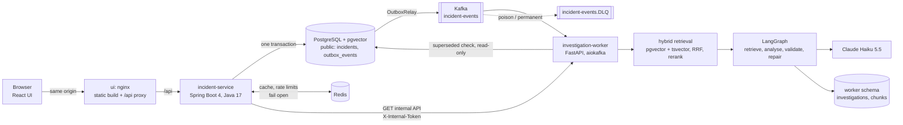

# Architecture

How the pieces fit, what each one owns, and what happens when one of them fails. Decisions and their alternatives are
in the ADRs ([docs/adr/](adr/)).

## Components

| Component | Owns | Talks to |
|---|---|---|
| **ui** (nginx, non-root) | the built React app; `/api` reverse proxy | incident-service |
| **incident-service** | incidents, tenants (from the JWT), RBAC, the outbox, investigation status rules, rate limits, cache | PostgreSQL (`public`), Redis, Kafka (relay), the worker's internal API |
| **investigation-worker** | investigations, evidence chunks, retrieval, the LLM call and its validation | Kafka, PostgreSQL (`worker`; read-only on `public.outbox_events` and `public.incidents`), Anthropic API |
| **PostgreSQL** | both schemas (Flyway for `public`, Alembic for `worker`) | |
| **Kafka** | `incident-events` (key = incident id) and its DLQ | |
| **Redis** | nothing authoritative: cache entries and rate-limit counters | |

## Flows

**Report an incident**
1. `POST /api/v1/incidents` (RESPONDER/ADMIN; per-tenant rate limit; optional `Idempotency-Key`: a retried request
   returns the incident the first one created, see below).
2. One transaction: the incident row and an `IncidentCreated` outbox row ([ADR 0001](adr/0001-transactional-outbox.md)).
3. `OutboxRelay` sends unsent rows to Kafka and marks them published.
4. The worker consumes the event:
   1. creates the PENDING investigation and its `processed_events` row (idempotent per event id);
   2. skips it as `SUPERSEDED` if a newer request exists for the incident ([ADR 0002](adr/0002-superseded-request-check.md));
   3. claims it (`run_count` fencing), retrieves evidence, asks Claude, validates citations, saves COMPLETED or FAILED
      ([ADR 0005](adr/0005-abstain-over-hallucinate.md));
   4. commits the offset (or dead-letters a poison message, then commits).

**Read an investigation**
1. `GET /api/v1/incidents/{id}/investigation`: tenant check in the database (404 for another tenant's incident).
2. Cache hit (COMPLETED/FAILED only) → answer ([ADR 0004](adr/0004-cache-only-terminal-investigations.md)).
3. Otherwise the worker's internal API (1 s connect, 3 s read timeout), plus the outbox for the status rules:
   PENDING / RUNNING (with `Retry-After`), COMPLETED, FAILED, or NOT_STARTED ([ADR 0006](adr/0006-not-started-and-retry.md)).

**Retry**: `POST .../investigation/retry` from NOT_STARTED or FAILED writes a new outbox event and evicts the cache.

**Idempotent create**: the key is stored with the incident under a unique `(tenant_id, idempotency_key)` index
(Flyway V6). Same key and same body → 200 with the original incident and `Idempotent-Replayed: true`, nothing new is
created or enqueued; same key, different body → 422; two concurrent requests with one key → the index lets one insert
win, the other's whole transaction (incident and outbox row) rolls back and it answers with the winner's incident.
The UI sends one key per report and gives up after 15 s with "the incident may have been saved; reporting it again is
safe".

## Failure behaviour

| Failure | What users see | Why |
|---|---|---|
| Worker down or slow | incidents are still created; investigation reads return 503 + `Retry-After` (cached finished ones still work) | outbox + Kafka decouple writes; reads call the worker synchronously |
| Kafka down | incidents are still created; requests wait in the outbox | the relay retries unsent rows |
| Redis down | everything works; no cache, no rate limit | fail open behind a circuit breaker ([ADR 0003](adr/0003-fail-open-redis-circuit-breaker.md)) |
| LLM error / invalid answer | FAILED with a reason; RESPONDERs can retry | validation and one repair attempt |
| LLM key or model misconfigured | investigation goes back to PENDING; worker `/health` 503 | not the incident's fault; re-run after the fix |
| Request lost before the worker | NOT_STARTED after 30 min, with Retry | [ADR 0006](adr/0006-not-started-and-retry.md) |
| incident-service container recreated | no 502s from the UI | nginx re-resolves the upstream ([ADR 0007](adr/0007-same-origin-no-cors.md)) |

## Security boundaries

- The tenant comes only from the verified JWT and is in every query, including vector search, the worker's internal
  API and the worker's outbox check.
- The worker's internal API needs `X-Internal-Token` and is not exposed outside the Docker network / cluster
  (NetworkPolicy in Kubernetes).
- Same origin for UI and API, CORS off, strict CSP ([ADR 0007](adr/0007-same-origin-no-cors.md)); the UI keeps the token in
  memory only.
