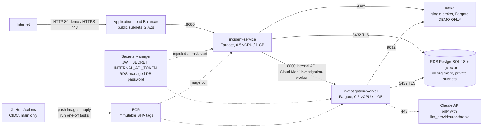

# AWS infrastructure (Terraform) — demo environment

Infrastructure as code for running ai-incident-platform on AWS (ECS Fargate, RDS, ALB). **Everything here is
plan-only until you decide otherwise:** CI only formats, validates, lints and scans it, with no AWS credentials.
Deploying creates billable resources: follow the steps below and **destroy the same day**.

## Architecture



Security groups are chained: ALB (80/443 from the internet) → incident-service (8080 from the ALB only) → worker
(8000 from incident-service only); RDS (5432) and Kafka (9092) accept only the application tasks.

## Layout

| Path | What it creates |
|---|---|
| `bootstrap/` | **Applied once, first.** $5/month budget with e-mail alerts (80%, 100%, forecast), the S3 state bucket (versioned, AES-256, public access blocked, TLS-only policy), the GitHub OIDC provider and two roles (below). Local state. |
| `envs/demo/` | The demo environment, composed from the modules; remote state in the bootstrap bucket (S3 native locking). |
| `modules/network` | VPC, 2 AZs, public + private subnets, internet gateway, optional single NAT gateway, locked-down default SG. |
| `modules/security_groups` | The five chained security groups. |
| `modules/ecr` | `incident-service` and `investigation-worker` repositories: immutable tags, scan on push, keep the last 10 images. |
| `modules/rds` | PostgreSQL (major version 18, like compose), db.t4g.micro, 20 GB gp3, encrypted, private, `rds.force_ssl=1`, master password generated and rotated by RDS in Secrets Manager. pgvector: the worker's migration runs `CREATE EXTENSION vector`. |
| `modules/secrets` | `JWT_SECRET` and `INTERNAL_API_TOKEN` (generated with ephemeral values + write-only arguments: never in the plan or state), and an empty `ANTHROPIC_API_KEY` secret when `llm_provider = "anthropic"`. |
| `modules/ecs_service` | One Fargate workload: log group (7 days), execution role (pull own image, write own logs, read own secrets), task role (no permissions), task definition (read-only root FS where possible), optional service with Cloud Map and ALB registration, circuit-breaker rollback. |
| `modules/kafka` | One `apache/kafka:4.1.0` broker (KRaft) as a Fargate service, ephemeral storage, plus the one-off topic-creation task. **Demo only** (see the file for MSK/SQS). |
| `modules/alb` | Public ALB → incident-service only; HTTP-only demo mode, or HTTPS (TLS 1.3 policy) + redirect with an ACM certificate; health check `/api/v1/health`. |
| `modules/budget` | The monthly budget (used by `bootstrap/`). |

Tags on everything (provider `default_tags`): `project=ai-incident-platform`, `env=demo`, `managed_by=terraform`.

## Key decisions

- **No MSK.** The smallest MSK cluster costs far more than this demo. One Kafka broker on Fargate with ephemeral
  storage is enough to show the event flow; a restart loses topics and unconsumed events (rerun the topics task).
- **NAT gateway off by default** (`enable_nat_gateway = false`). Without NAT, tasks need public IPs to reach ECR,
  Secrets Manager, CloudWatch and the Claude API, so they run in the public subnets. Their security groups accept
  no inbound traffic except from the chained groups, and allow outbound only on 443 and to RDS/Kafka/the worker.
  RDS stays private either way. With NAT, tasks move to the private subnets without public IPs.
- **Secrets** come only from Secrets Manager, as ECS `secrets` (`valueFrom`), never plain environment variables.
  The DB password is RDS-managed and rotated. Its username and password are injected separately, so the worker
  builds its URL with the password URL-encoded (`DB_HOST`/`DB_PASSWORD`…, `app/config.py`).
- **State:** S3 with `use_lockfile = true` (native S3 locking, Terraform ≥ 1.10), no DynamoDB table.
- **GitHub OIDC, two roles.** Both trust only `repo:SandeepKonduruRaju/ai-incident-platform:ref:refs/heads/main`.
  - `github-deploy` is least privilege: push the two ECR repositories, run tasks in the cluster, update the two
    services, and `iam:PassRole` only for `/ai-incident-platform/` task roles.
  - `github-terraform` runs apply/destroy: limited to this stack's services, IAM roles under the project path, and
    the state bucket.
  - The GitHub roles live under a different path, so the terraform role cannot edit them (no privilege escalation).

## Estimated cost (ESTIMATES, not quotes)

Approximate on-demand list prices for eu-west-2 in 2026; they change and differ per region. Check
[Fargate](https://aws.amazon.com/fargate/pricing/), [RDS PostgreSQL](https://aws.amazon.com/rds/postgresql/pricing/),
[ALB](https://aws.amazon.com/elasticloadbalancing/pricing/), [VPC/NAT/public IPv4](https://aws.amazon.com/vpc/pricing/),
[Secrets Manager](https://aws.amazon.com/secrets-manager/pricing/) and the
[AWS Pricing Calculator](https://calculator.aws/) before deploying.

| Item | Without NAT (default) | With NAT |
|---|---|---|
| Fargate: 3 services × 0.5 vCPU / 1 GB, 24 h | ≈ $2.0 / day | ≈ $2.0 / day |
| ALB (hours + minimal LCU) | ≈ $0.7 / day | ≈ $0.7 / day |
| RDS db.t4g.micro single-AZ + 20 GB gp3 | ≈ $0.5 / day | ≈ $0.5 / day |
| Public IPv4 addresses (ALB ×2 + 3 tasks without NAT) | ≈ $0.6 / day | ≈ $0.3 / day |
| NAT gateway (hours + a little data) | — | ≈ $1.3 / day |
| Secrets Manager (4 secrets), ECR storage, logs, Cloud Map, S3 state | < $0.2 / day | < $0.2 / day |
| **Total (rough)** | **≈ $4 / day (≈ $115 / month)** | **≈ $5 / day (≈ $145 / month)** |

**A few hours of demo ≈ $1–2.** Left running, the $5 budget is exceeded within about a day and a half: the budget only
**alerts**, it does not stop anything. Destroying is the cost control.

## Steps

### 0. Prerequisites (local)

Terraform 1.16, the AWS CLI, an AWS account with an admin-capable profile for the one-time bootstrap
(`aws configure sso` or `aws configure`). Never commit credentials, `*.tfvars` or state (all gitignored).

### 1. Bootstrap (once; creates the budget FIRST, costs cents)

```powershell
cd infra/bootstrap
Copy-Item terraform.tfvars.example terraform.tfvars   # set budget_alert_email
terraform init
terraform plan                       # review: budget, state bucket, OIDC provider, 2 roles
terraform apply
terraform output                     # note state_bucket and the two role ARNs
```

Then in GitHub → Settings → Secrets and variables → Actions → **Variables** (not secrets; nothing secret here):
`AWS_REGION`, `AWS_DEPLOY_ROLE_ARN`, `AWS_TERRAFORM_ROLE_ARN`, `TF_STATE_BUCKET`, and only when you want to
deploy, `AWS_DEPLOY_ENABLED=true`.

### 2. Deploy (costs money from here on)

Actions → **Deploy to AWS (manual)** → Run workflow on `main` (choose `fake` for the LLM). It runs these steps:
1. Applies the ECR repositories.
2. Builds and pushes the images tagged with the commit SHA.
3. Applies the stack.
4. Runs the topics, migrate and ingest one-off tasks.
5. Waits for the services to be stable, then smoke-tests `<alb>/api/v1/health`.

For `llm_provider = anthropic`, put the key into the secret first:
`aws secretsmanager put-secret-value --secret-id ai-incident-platform/demo/anthropic-api-key --secret-string <key>`
(after the first apply has created the empty secret).

### 3. Verify

- The workflow summary shows the ALB URL.
- `curl <alb_url>/api/v1/health` returns `{"status":"UP",...}`.
- Logs: CloudWatch `/ecs/ai-incident-platform-demo/*`.
- Calling the API needs a JWT. There is no identity provider in the demo. Setting `spring_profiles_active = "dev"`
  enables `POST /api/v1/dev/token` for **anyone who can reach the ALB**: only for a short demo with synthetic data.

### 4. Destroy (the same day)

Actions → **Destroy AWS demo (manual)** → type `destroy-demo`. It ends by checking that the state is empty.
Then check that nothing is left:
- Billing console: no running Fargate tasks, ALB, RDS instance or NAT gateway.
- The budget e-mails stop growing.

Locally instead: `cd infra/envs/demo; terraform init -backend-config=backend.hcl; terraform destroy -var image_tag=<any sha>`.

Removing the bootstrap too (optional, costs almost nothing to keep):
1. Empty the state bucket, including all object versions.
2. In `infra/bootstrap`, run `terraform destroy`.
3. Delete `AWS_DEPLOY_ENABLED` in GitHub.

## Production differences

| Demo | Production |
|---|---|
| Single Kafka broker on Fargate, ephemeral | Amazon MSK (3 brokers, multi-AZ, IAM/TLS auth), or SQS with code changes |
| RDS single-AZ, 1-day backups, no deletion protection, skip final snapshot | Multi-AZ, 7–35-day backups, `deletion_protection = true`, final snapshot, Performance Insights, IAM auth/RDS Proxy |
| No NAT, tasks with public IPs | NAT per AZ (or VPC endpoints), all tasks private |
| HTTP-only ALB, no WAF | HTTPS only (ACM), AWS WAF, access logs, deletion protection |
| Worker reachable via Cloud Map + security group | The same, or an internal ALB / service mesh with mTLS |
| AWS-managed KMS keys, no flow logs, no Container Insights | Customer-managed KMS keys, VPC flow logs, Container Insights, alarms |
| 1 task per service | ≥ 2 incident-service tasks across AZs + autoscaling; worker = partition count |
| Dev token endpoint possible | A real identity provider (Cognito/Keycloak/Okta) |
